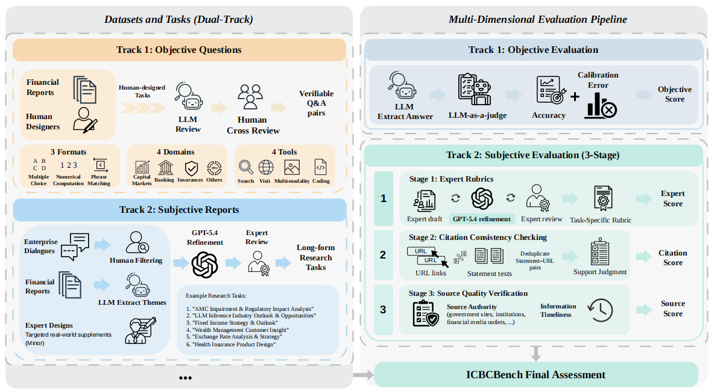

<h1 align="center">ICBCBench: An Industry Consortium Benchmark for Financial Deep Research</h1>

<div align="center">
<a href="https://arxiv.org/abs/2606.17458" target="_blank"></a>
<a href="https://huggingface.co/datasets/DeepFin-Intelligence/ICBCBench"></a>
<a href="https://huggingface.co/spaces/DeepFin-Intelligence/ICBCBench-Leaderboard"></a>
<a href="https://github.com/DeepFin-Intelligence/ICBCBench/blob/main/LICENSE"></a>
</div>


## Overview

ICBCBench is an industry consortium benchmark for evaluating financial Deep Research Agents in real-world research scenarios. It consists of bilingual objective and subjective tasks across major financial sectors, including capital markets, banking, insurance, and related financial services. Developed with over 50 contributors from more than 40 financial and academic organizations, ICBCBench combines verifiable question answering with expert-aligned long-form report evaluation to assess retrieval–reasoning accuracy, factual grounding, citation reliability, and end-to-end report quality.


 <p align="center">
  
</p>


## Directory Structure

```
evaluation_toolkit/
├── objective_eval/                 # Objective question evaluation
│   ├── predict.py                      # Generate model predictions
│   ├── judge.py                        # Judge model answers
│   └── metrics.py                      # Compute Accuracy / Calibration Error
├── subjective_eval/                # Subjective research report evaluation
│   ├── write.py                        # Generate research reports with models
│   ├── ExpertCriteria/                 # Expert-criteria based scoring
│   │   ├── score_by_criteria.py        # Score reports by criteria
│   │   └── stat.py                     # Aggregate jsonl scores to leaderboard CSV
│   ├── FACT/                           # Citation extraction, deduplication, scraping, validation, and scoring
│   │   ├── extract.py
│   │   ├── deduplicate.py
│   │   ├── scrape.py
│   │   ├── validate.py
│   │   ├── stat.py
│   │   ├── authority.py
│   │   ├── time_decay.py
│   │   └── utils.py
│   └── scoring/                        # Final score aggregation
│       └── compute_final_score.py      # Merge ExpertCriteria + FACT into final leaderboard
├── DR_clients/                     # Deep Research model clients
├── model_clients.py                # API client collection
└── utils.py                        # JSON / PDF utilities
```

## Installation

Use **Python 3.12** (verified locally with 3.12.13) and an isolated environment.
The commands below select the `Zhiwei` release branch:

```bash
git clone --branch Zhiwei https://github.com/DeepFin-Intelligence/ICBCBench.git
cd ICBCBench
python3.12 -m venv .venv
source .venv/bin/activate
python -m pip install -r requirements-lock.txt
python -m pip check
python -m evaluation_toolkit check
```

On Windows, activate with `.venv\Scripts\Activate.ps1` in PowerShell.
`requirements-lock.txt` pins the tested direct and transitive dependencies;
`requirements.txt` lists minimum/direct requirements for development. The
Tavily SDK package is `tavily-python`, not the unrelated `tavily` package.

## Quick Start

First verify scoring and aggregation without API keys or network access:

```bash
python -m evaluation_toolkit demo --output_dir eval_result/offline_demo
python -m unittest discover -s tests -v
```

The demo writes explicitly **synthetic** bilingual inputs, per-task scores,
three expert rounds, citation metrics and final CSVs. Expected synthetic results:
objective accuracy **50%**, subjective final score **74.00**. It tests scoring and
aggregation, not live generation or model performance. Use an empty output folder.

For live evaluation, configure the keys below, then preview a two-task-per-track
run. The date is an explicit reference date for source timeliness; choose and
report the date appropriate to your experiment.

```bash
python -m evaluation_toolkit check --model gpt-4o
python -m evaluation_toolkit run \
    --model gpt-4o --track both --limit 2 \
    --expert_rounds 3 --as_of 2026-10-16 \
    --run_dir eval_result/gpt4o-smoke --dry_run
```

Remove `--dry_run` to execute the plan (**paid provider calls and source downloads**).
For all 80 objective and 40 subjective tasks, omit `--limit` and use a new run
folder. `--language en` or `--language zh` restricts the task set. Bilingual small
runs alternate English and Chinese tasks, preserving original IDs. Every stage
uses the same saved subset, so coverage and averages have the correct denominator.

The runner executes prediction/judging/metrics and report generation, **three
independent expert scoring passes**, FACT and final aggregation. Inspect:

- `RUN_DIR/objective/metrics/evaluation_results.csv` and language-specific CSVs;
- `RUN_DIR/subjective/expert_round_*/judge_gemini-3.1-pro/scores_gpt-4o.jsonl` for per-task raw and normalized expert scores;
- `RUN_DIR/subjective/final_leaderboard.csv`, `final_leaderboard_en.csv`, `final_leaderboard_zh.csv`;
- `RUN_DIR/run_manifest.json`, `inputs/` and `logs/` for configuration, dependencies, frozen task subsets and stage logs.

Only languages present in the subset produce language-specific results. On a
stage failure the runner stops and retains successful records; rerun the same
command to resume. Only a manifest with `status: complete` represents a finished
run; earlier CSVs may still exist after an interrupted attempt. A changed model, judge, task set, date, code or dependency
version requires a new run folder. Run one process per output folder.
Use `--objective_judge`, `--expert_judge`, and `--fact_judge` to select judges;
defaults are `gpt-5.4`, `gemini-3.1-pro`, and `google/gemini-3-flash-preview`.
A fresh run reproduces this release's evaluation procedure, not necessarily the
historical Table 1 numbers. See [reproduction conventions](docs/REPRODUCIBILITY.md).

## Environment Variables

API keys are loaded from a `.env` file in the project root. Copy `.env.example` to `.env` and fill in the required keys:

```bash
cp .env.example .env
```

Current clients use `OPENROUTER_API_KEY` as the default. Refer to `model_clients.py` and `.env.example` for all supported keys.

Only the selected provider needs a key: ordinary models, Tongyi, and FACT use
`OPENROUTER_API_KEY`; Gemini DR uses `GEMINI_API_KEY`; OpenAI DR uses
`OPENAI_API_KEY`; Tavily uses `TAVILY_API_KEY`; Qwen DR uses `DASHSCOPE_API_KEY`.
Configuration is read from this project's `.env`, and `--help` does not require keys.
Short names such as `gpt-4o`, `gpt-5.4`, and `gemini-3.1-pro` are supported,
as are full OpenRouter IDs such as `openai/gpt-4o`. Output filenames use the
last component of a full model ID (for example, `gpt-4o.json`).

## License and Redistribution

The evaluation code is released under the [MIT License](LICENSE). The
benchmark-authored public task text, reference answers, and expert evaluation
rubrics are released under [Apache-2.0](data/LICENSE), as specified by the
existing Hugging Face dataset card. See [data license scope](data/DATA_LICENSE.md)
for the distinction between these materials and third-party sources.

Redistribution of the task data must comply with Apache-2.0, including providing
a copy of the license, retaining applicable notices, and identifying changes.
The data license does not grant rights to redistribute third-party reports,
charts, images, trademarks, or other source material.

The two figures referenced by objective question **25** are now represented by
official BNP Paribas PDF URLs and page locators. The prepared release contains
these references rather than copies of the third-party images or PDFs. Source
attribution and the publisher's terms are recorded in
[third-party sources](data/THIRD_PARTY_SOURCES.md).

## Data Paths

Default data files are expected under the project root:

- Objective questions: `data/objective_questions_public_80.json`
- Subjective questions: `data/subjective_questions_public_40.json`

The bundled JSON files are a URL-reference revision of the public
[Hugging Face dataset](https://huggingface.co/datasets/DeepFin-Intelligence/ICBCBench/tree/c1cbb5ed75daf6225035dbd89737aef1da86557f)
at commit `c1cbb5ed75daf6225035dbd89737aef1da86557f` (updated 2026-09-14).
This revision replaces question 25's two bundled image attachments with official
source URLs and page locators; it does not change the reference answer.
`data/huggingface_version.json` records the upstream source and the files in
the GitHub `Zhiwei` branch. Updating this GitHub branch does not update the
remote Hugging Face dataset; its URL-reference revision remains unpublished.

Use `--local_dataset` with the bundled JSON files to evaluate this revision. For a multimodal model, the toolkit retrieves each linked source PDF
and renders the designated page in memory for the request, without writing
third-party PDFs or page images to a disk cache. For a text-only model, the task
provides the source URLs and page descriptions. Source retrieval and rendering
do not grant redistribution rights to the publisher's material.

Historical Table 1 runs used the bundled screenshots. Replacing those inputs
with rendered PDF pages or URL references changes the evaluation input; the new
input format is not guaranteed to reproduce the published Table 1 scores.

Prediction, judging, and report generation also accept
`--dataset DeepFin-Intelligence/ICBCBench` in place of `--local_dataset`.
The objective entry points select `objective_questions`; report generation
selects `subjective_questions`. Both use the published `train` split.
Questions and any attachments in the selected remote revision are downloaded
from the same resolved HF snapshot. The following examples pin the historical
upstream revision, which still uses its original attachment format; they do not
select this branch's URL-reference revision:

```bash
python evaluation_toolkit/objective_eval/predict.py \
    --dataset DeepFin-Intelligence/ICBCBench \
    --dataset_revision c1cbb5ed75daf6225035dbd89737aef1da86557f \
    --model gpt-4o

python evaluation_toolkit/subjective_eval/write.py \
    --dataset DeepFin-Intelligence/ICBCBench \
    --dataset_revision c1cbb5ed75daf6225035dbd89737aef1da86557f \
    --model gpt-4o
```

`--dataset_config`, `--dataset_split`, and `--dataset_revision` override HF
loading options. Other HF repositories retain the default `test` split.
Local JSON loading does not download HF files. Models still require the
corresponding API credentials.

Generated evaluation results are written to `eval_result/`:

- Model reports: `eval_result/subjective_eval/dr_reports/reports_<model>.json`
- Objective predictions: `eval_result/objective_eval/prediction_results/<model>.json`
- Objective judged results: `eval_result/objective_eval/judged_results/judge_<judge>/judged_<model>.json`
- Objective metrics: `eval_result/objective_eval/evaluation_results.csv`
- Subjective scores: `eval_result/subjective_eval/scores/judge_<judge>/scores_<model>.jsonl`
- Subjective leaderboard: `eval_result/subjective_eval/scores/judge_<judge>/leaderboard.csv`
- FACT results: `eval_result/subjective_eval/fact_result.csv`
- Final leaderboard: `eval_result/subjective_eval/final_leaderboard.csv`

## Objective Evaluation Pipeline

### 1. Generate Predictions

```bash
python evaluation_toolkit/objective_eval/predict.py \
    --local_dataset data/objective_questions_public_80.json \
    --model gpt-4o \
    --num_workers 2
```

Outputs: `eval_result/objective_eval/prediction_results/gpt-4o.json`

### 2. Judge Predictions

```bash
python evaluation_toolkit/objective_eval/judge.py \
    --local_dataset data/objective_questions_public_80.json \
    --predictions eval_result/objective_eval/prediction_results/gpt-4o.json \
    --judge gpt-5.4 \
    --num_workers 5
```

Outputs:
- `eval_result/objective_eval/judged_results/judge_<judge>/judged_gpt-4o.json`
- `eval_result/objective_eval/evaluation_results.csv`

### 3. Compute Metrics

```bash
python evaluation_toolkit/objective_eval/metrics.py
```

Pass `--judge <judge>` when using a different judge. `--query_file`,
`--judged_dir`, and `--output_dir` can be used for isolated subset evaluations.

Reads judged results from `eval_result/objective_eval/judged_results/judge_<judge>/` and writes metrics to `eval_result/objective_eval/`.

## Subjective Evaluation Pipeline

### 1. Generate Reports

```bash
python evaluation_toolkit/subjective_eval/write.py \
    --local_dataset data/subjective_questions_public_40.json \
    --model gpt-4o \
    --num_workers 2
```

Outputs: `eval_result/subjective_eval/dr_reports/reports_gpt-4o.json`

### 2–3. ExpertCriteria Scoring and Aggregation

Keep each of the three scoring rounds in its own directory; rerunning a scorer
in the same directory resumes its cache rather than creating another round.
The unified runner above handles this automatically. Equivalent Bash commands:

```bash
for round in 1 2 3; do
    python evaluation_toolkit/subjective_eval/ExpertCriteria/score_by_criteria.py \
        --judge gemini-3.1-pro --report_model gpt-4o \
        --output_dir "eval_result/subjective_eval/expert_round_${round}" || exit 1
    for language in all en zh; do
        filter=()
        if [ "$language" != all ]; then filter=(--language_filter "$language"); fi
        python evaluation_toolkit/subjective_eval/ExpertCriteria/stat.py \
            --input_dir "eval_result/subjective_eval/expert_round_${round}/judge_gemini-3.1-pro" \
            --query_file data/subjective_questions_public_40.json \
            --output_csv "eval_result/subjective_eval/expert_round_${round}/judge_gemini-3.1-pro/leaderboard.csv" \
            "${filter[@]}" || exit 1
    done
done
```

### 4. FACT Evaluation

Run the FACT pipeline (`extract.py`, `deduplicate.py`, `scrape.py`, `validate.py`) to produce a validated citation file, then compute FACT metrics:

```bash
python evaluation_toolkit/subjective_eval/FACT/extract.py \
    --raw_data_path eval_result/subjective_eval/dr_reports/reports_gpt-4o.json \
    --query_data_path data/subjective_questions_public_40.json \
    --output_path eval_result/subjective_eval/fact/extracted_gpt-4o.jsonl \
    --judge google/gemini-3-flash-preview --n_total_process 1

python evaluation_toolkit/subjective_eval/FACT/deduplicate.py \
    --raw_data_path eval_result/subjective_eval/fact/extracted_gpt-4o.jsonl \
    --query_data_path data/subjective_questions_public_40.json \
    --output_path eval_result/subjective_eval/fact/deduped_gpt-4o.jsonl \
    --judge google/gemini-3-flash-preview --n_total_process 1

python evaluation_toolkit/subjective_eval/FACT/scrape.py \
    --raw_data_path eval_result/subjective_eval/fact/deduped_gpt-4o.jsonl \
    --output_path eval_result/subjective_eval/fact/scraped_gpt-4o.jsonl \
    --n_total_process 1

python evaluation_toolkit/subjective_eval/FACT/validate.py \
    --raw_data_path eval_result/subjective_eval/fact/scraped_gpt-4o.jsonl \
    --query_data_path data/subjective_questions_public_40.json \
    --output_path eval_result/subjective_eval/fact/validated_gpt-4o.jsonl \
    --judge google/gemini-3-flash-preview --n_total_process 1
```

```bash
python evaluation_toolkit/subjective_eval/FACT/stat.py \
    --model_name gpt-4o \
    --input_path eval_result/subjective_eval/fact/validated_gpt-4o.jsonl \
    --output_csv eval_result/subjective_eval/fact_result.csv \
    --query_file data/subjective_questions_public_40.json --as_of 2026-10-16
```

### 5. Compute Final Score

```bash
python evaluation_toolkit/subjective_eval/scoring/compute_final_score.py \
    --expert_dirs eval_result/subjective_eval/expert_round_1/judge_gemini-3.1-pro \
                  eval_result/subjective_eval/expert_round_2/judge_gemini-3.1-pro \
                  eval_result/subjective_eval/expert_round_3/judge_gemini-3.1-pro \
    --fact_csv eval_result/subjective_eval/fact_result.csv \
    --output_dir eval_result/subjective_eval \
    --alpha 0.8 --beta 0.1 --gamma 0.1
```

Outputs: `eval_result/subjective_eval/final_leaderboard.csv`

The final score formula is:

```
S_final = alpha * S_expert + beta * S_citation + gamma * S_source
```

## Notes

- All scripts can be run directly or as modules (`python -m evaluation_toolkit.objective_eval.predict ...`).
- Prefer the unified runner’s `--limit` for small complete evaluations. Individual
  scripts’ `--max_samples` limits generation/scoring only; downstream aggregation
  must receive a matching subset JSON or it will correctly report incomplete coverage.
- Set `--num_workers` / `--max_workers` according to your API rate limit.
- The FACT pipeline expects `citations_deduped` in the input data with fields such as `facts`, `validate_res`, `publish_time`, and `true_url`.
- Prediction, report generation, expert scoring, and FACT model stages return a nonzero exit status when tasks fail. Successful records are saved for retry.
- Expert averages include genuine zero scores; tasks without a recorded score are excluded.
- Public subjective data uses `question` and `expert_evaluation_criteria` for both languages. Legacy bilingual fields remain supported.
- Objective accuracy uses every question in the selected dataset as its denominator;
  `Total`, `Evaluated`, and `Coverage (%)` make incomplete evaluations visible.
  Expert and FACT statistics also report task coverage. Incomplete stages return
  a nonzero status, and final aggregation rejects incomplete score inputs.
- Successful results are saved atomically as tasks complete. Changing a question,
  attachment, report, rubric, model parameters, or judge invalidates the relevant
  cached result. Legacy caches without input fingerprints are evaluated again.
- A failed replacement removes the stale result before the new request. Caches
  cannot combine different providers with the same model basename. Standalone
  objective metrics verify each judgment against its question and judge.
- Expert and FACT CSVs carry task-set and original-report fingerprints. Final
  aggregation requires complete coverage, matching provenance across all
  expert rounds and FACT, and a common `Evaluation As Of (UTC)` date. Regenerate
  older FACT CSVs with `--as_of` when this field is missing. Intermediate expert
  CSVs preserve full numeric precision; final score columns display two decimals.
  Duplicate task records fail explicitly rather than overwriting one another.
- Truncated or filtered model responses are failed tasks even when their text
  or JSON is nonempty. OpenAI and Gemini clients try to cancel running background
  jobs when polling fails, times out, or the client invocation is interrupted.
  Parent-pipeline interruption signals research workers to stop polling. A failed
  cancellation reports the remote task ID; Tavily polling failures retain its
  task ID because this API does not expose cancellation.
- Provider citation annotations and sources are preserved in generated reports.
  Known offsets or explicit reference numbers become Markdown links. Tavily's
  source list does not document numeric reference IDs; when numeric citations
  lack URLs and an explicit mapping, FACT fails instead of guessing source order.
- PDF and Excel attachments are read in full by default. Attachment paths are
  relative to the selected dataset file. A failed PDF table conversion preserves
  its text; scanned PDFs without extractable text require preprocessing.
- Models that reject required image input fail explicitly; a text-only answer
  cannot replace the required image evaluation. Tavily and the current Qwen
  Deep Research client reject image tasks. Qwen's official API and main guide
  give inconsistent image schemas; this client uses the text API contract.
- `JINA_API_KEY` is optional for FACT scraping. Without it, or after Jina fails,
  the scraper uses its local HTML/PDF extraction path.
- Public subjective question **36** retains its original rubric. Primary dimension
  2 declares 30 points but its secondary items total 36. The author-approved
  convention scores those items on their original scales, then multiplies their
  sum by **30/36**. Other primary dimensions are unchanged. JSONL scores retain
  `dimensions_breakdown`, `raw_total_score`, `total_score` and `scoring_adjustments`.
  The correction is bound to the exact released rubric hash; other malformed
  rubrics still fail validation. This convention is explicitly different from
  uncorrected historical scoring; see [details](docs/REPRODUCIBILITY.md).
- Additional public-data issues require author clarification: objective questions
  44, 51, and 53 refer to unspecified reports that are not attached; question 62
  lacks a target P/EV assumption; question 53's requested output layout conflicts
  with its answer layout. Question 28's JPMorgan answer conflicts with the 2024
  annual-report deposit figures under a deposit-amount insurance-coverage ratio.
  The nine Multi-Modal rows without attachments are 3, 28, 32, 51, 52, 55, 62,
  78, and 80; empty attachments alone do not prove an error where public source
  retrieval is intended. These answers have not been silently changed.

## Offline Regression Checks

```bash
python -m unittest discover -s tests -v
```

These checks use real SDKs with local HTTP transports, real HTML/PDF extraction,
and simulated service responses. They cover all 80 objective questions, all 40
subjective questions (including the explicit task 36 correction), bilingual data,
images, interrupted runs, cache invalidation, malformed responses, multiprocessing,
and final-score aggregation. They do not use live API keys or generate benchmark scores.


## Contact

For questions or feedback about ICBCBench, please contact:

- **Zhiwei Tang**: [zwtang1220@gmail.com](mailto:zwtang1220@gmail.com)
- **Weiya Li**: [weiyali126@outlook.com](mailto:weiyali126@outlook.com)
- **Yizhou He**: [jonah_he@163.com](mailto:jonah_he@163.com)
- **Li Guo**: [guo_li@fudan.edu.cn](mailto:guo_li@fudan.edu.cn)
- **Linfeng Zhang**: [zhanglinfeng@sjtu.edu.cn](mailto:zhanglinfeng@sjtu.edu.cn)

## Citation

```bibtex
@misc{li2026icbcbenchindustryconsortiumbenchmark,
      title={ICBCBench: An Industry Consortium Benchmark for Financial Deep Research}, 
      author={Weiya Li and Zhiwei Tang and Yizhou He and Chenghao Wang and Liang Feng and Xiao Sun and Dongrui Liu and Zichen Wen and Hu Wei and Jinghang Wang and Yi Luo and Li Guo and Linfeng Zhang},
      year={2026},
      eprint={2606.17458},
      archivePrefix={arXiv},
      primaryClass={cs.CE},
      url={https://arxiv.org/abs/2606.17458}, 
}
``` 
